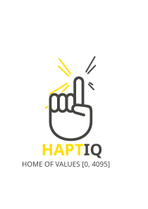
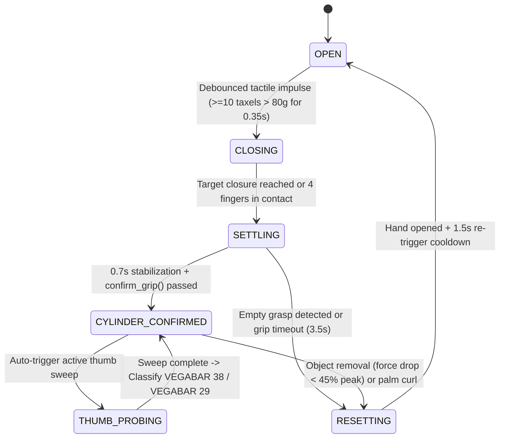

<p align="center">
  
</p>

# HaptIQ

**Autonomous Tactile Control, Slip Detection, and Blind Object Identification for the Inspire-Robots RH56DFTP Dexterous Hand**

HaptIQ is a real-time tactile intelligence and grasp control framework developed at the Blackforest Hackathon 2026 x VEGA Grieshaber KG. Built for the **Inspire-Robots RH56DFTP** 6-DOF dexterous robotic hand, HaptIQ fuses high-density distributed tactile array sensing (~1,062 taxels across 17 sensor patches) with actuator force, kinematics and tactile feedback to autonomously grasp objects, verify grip quality, detect foreign objects, monitor grip stability and slip, detect object handover/removal, and perform blind in-hand identification of industrial pressure sensors (**VEGABAR 38** vs. **VEGABAR 29**) via active thumb probing.

---

## Features

- **Autonomous Grasp Finite State Machine (`GraspManager`)**
  - End-to-end grasp lifecycle orchestration (`OPEN -> CLOSING -> SETTLING -> CYLINDER_CONFIRMED -> THUMB_PROBING -> RESETTING`).
  - Edge-triggered, debounced tactile contact initiation (`>= 10` active taxels exceeding `80g` over `0.35s`) with post-release cooldown protection.
  - Automatic abort and reset on empty-grasp closures or premature finger curl into the palm.
  - Continuous peak-force retention tracking during confirmed holds to detect intentional object removal (`< 45%` total peak force or `< 2` fingers retaining `35%` peak force for `0.15s`) and trigger smooth release.

- **Active Thumb Probing & Blind Sensor Classification (`ThumbProber`)**
    - Background-threaded touch-and-retract exploration executed automatically once a verified four-finger grasp is stabilized.
    - Sweeps thumb opposition rotation across three stations (`Rot = [995, 850, 700]`) while stepping thumb flexion inward (`995 -> 200`) under gentle force control (`150g` limit).
    - Performs per-station baseline force (`F0`) and tactile matrix taring prior to flexion to isolate net contact forces from mechanical self-loading.
    - Classifies industrial pressure transmitters in-hand without vision:
        - **VEGABAR 38**: Detected via shallow geometric contact (`Bend >= 600` accompanied by physical force rise `>= 50g`, tactile array activation, or preload resistance against the wider upper housing).
        - **VEGABAR 29**: Detected when the thumb flexes deep into free space (`Bend < 600` or no upper-housing obstacle across the sweep).
    - Due to scanning logic, extendible to full raster and point cloud scanning and shape fitting.

- **Cylindrical Grip Verification (`grip_logic`)**
    - Multi-taxel spatial noise filtering (`>= 2` active taxels `> 50g` per sensor patch).
    - Validates cylindrical grasp geometry using four-finger flexion angle homogeneity (`max - min <= 75`), active finger count (`>= 3` of Little, Ring, Middle, Index), missed-finger over-flexion checks, and inter-finger force balance ratio (`max / min <= 6.0`).

- **Real-Time Tactile Slip & Pull-Out Detection (`TactileSlipDetector`)**
    - Computes Exponential Moving Average (EMA, `alpha = 0.6`) Center of Pressure (CoP) trajectories across the palm (`8x14`) and fingertip/nail (`12x8`) taxel matrices.
    - Flags slip events within a `250ms` sliding window by combining spatial CoP displacement (`>= 0.45` taxel cells), localized pressure drop rate (`dF/dt <= -150g/s`), and global four-finger dynamic unloading (`<= -400g/s` with `>= 12%` drop).

- **Thread-Safe Modbus TCP Driver (`RobotHandController`)**
    - Synchronized `~33 Hz` (`30ms` cycle) telemetry and command interface to the RH56DFTP hand over Modbus TCP (`192.168.123.210:6000`).
    - Batched register reads (`<= 120` registers per request) for 17 tactile patches plus 6-DOF actual angles (`ANGLE_ACT`), signed forces (`FORCE_ACT`), actuator strokes (`POS_ACT`), motor currents, temperatures, and error codes.
    - Soft mechanical angle clamping (`5..995`), configurable velocity and force limits, startup zero-load calibration, and automatic mock-simulation fallback when running offline.

- **Interactive Control UI, Telemetry Logging & Digital Twin**
    - **Tkinter Dashboard (`HandApp`)**: Live 17-patch tactile heatmaps with CoP markers, FSM state banner, real-time slip alert indicator, post-probe sensor classification banner (`SENSOR: VEGABAR 38` / `SENSOR: VEGABAR 29`), manual 6-DOF sliders, and preset pose management.
    - **CSV Dataset Logger (`RobotDatabase`)**: Buffered recording of full actuator state and downsampled tactile summaries to `main_dataset.csv` and event-driven state transitions to `state_changes.csv`.
    - **3D/2D WebGL Digital Twin (`TwinPublisher`)**: Non-blocking background HTTP publisher streaming live joint kinematics and full 1,062-taxel arrays to a browser-based 3D hand twin and 2D tactile matrix inspector.

---

## System Architecture & Grasp Pipeline



### Hardware Degree-of-Freedom Mapping

| DOF Index | Joint Name | Angle Range (Internal) | Physical Mapping |
| :--- | :--- | :--- | :--- |
| `0` | Little Finger | `5 - 995` (`0 - 1000` raw) | `0` = Closed, `1000` = Open |
| `1` | Ring Finger | `5 - 995` (`0 - 1000` raw) | `0` = Closed, `1000` = Open |
| `2` | Middle Finger | `5 - 995` (`0 - 1000` raw) | `0` = Closed, `1000` = Open |
| `3` | Index Finger | `5 - 995` (`0 - 1000` raw) | `0` = Closed, `1000` = Open |
| `4` | Thumb Bend (Flexion) | `5 - 995` (`0 - 1000` raw) | `0` = Flexed, `1000` = Extended |
| `5` | Thumb Rotate (Opposition) | `5 - 995` (`0 - 1000` raw) | `0` = Palmar Opposition, `1000` = Lateral |

---

## Project Structure

```text
blackforest/
├── src/
│   ├── main.py                      # 30ms real-time control loop & application entry point
│   ├── config/
│   │   └── positions.json           # Saved 6-DOF hand pose presets
│   ├── interface/
│   │   ├── robot_control.py         # Thread-safe Modbus TCP driver, tactile reader & calibration
│   │   └── robot_dataset.py         # Buffered CSV logger (main_dataset.csv, state_changes.csv)
│   ├── logic/
│   │   ├── grasp_manager.py         # Autonomous grasp FSM, contact debounce & removal detection
│   │   ├── grip_logic.py            # Multi-taxel filtering, cylinder confirmation & empty-grasp checks
│   │   ├── thumb_prober.py          # Active thumb sweep & VEGABAR 38 vs. VEGABAR 29 classifier
│   │   ├── slip_detector.py         # CoP velocity & dF/dt tactile slip detection
│   │   └── twin_publisher.py        # Non-blocking HTTP state publisher for the Digital Twin
│   └── ui/
│       ├── appInterface.py          # Tkinter GUI, 17-patch tactile visualizer & status banners
│       └── Hand_Points.png          # Hand diagram backdrop for tactile heatmap overlays
├── digital_twin/
│   ├── bridge_server.py             # HTTP bridge server (port 18765) for live browser visualization
│   ├── hand_twin_6dof.html          # WebGL2 3D articulated hand & tactile heatmap viewer
│   └── tactile_2d.html              # 2D 1,062-taxel matrix inspector
├── check_errors.py                  # CLI diagnostic utility for actuator errors, temps & currents
├── API-Reference.md                 # RH56DFTP Modbus register map & hardware documentation
├── DIGITAL_TWIN.md                  # Digital Twin setup and usage guide
└── pyproject.toml                   # Project dependencies and metadata (managed via uv)
```

---

## Prerequisites

- **Python**: `>= 3.14` (with `tkinter` support enabled)
- **Package Manager**: [`uv`](https://docs.astral.sh/uv/)
- **Hardware (Optional for Simulation)**:
  - Inspire-Robots **RH56DFTP** Dexterous Hand connected via Ethernet (`192.168.123.210`, port `6000`, Modbus unit ID `1`).
  - Host network interface configured on the `192.168.123.x/24` subnet.
  - If the hardware is unreachable, HaptIQ automatically boots in **Simulation Mode** with synthetic kinematics and tactile feedback.

---

## Installation

1. Clone the repository:
   ```bash
   git clone <repository-url>
   cd blackforest
   ```

2. Install dependencies and create the virtual environment using `uv`:
   ```bash
   uv sync
   ```

---

## Usage

### 1. Launch the HaptIQ Control Application

Run the main control loop and Tkinter user interface:

```bash
uv run python src/main.py
```
or ```bash
uv run haptiq
```

#### Operating Modes in the UI:
- **Autonomous Grasping**: Leave the hand in the `OPEN` state and present a cylindrical object (e.g., VEGABAR 38 or VEGABAR 29) against the fingers or palm. Sustained tactile contact (`0.35s`) triggers automatic closure (`CLOSING -> SETTLING -> CYLINDER_CONFIRMED`), followed immediately by the 3-station thumb probing sweep (`THUMB_PROBING`). Once probing finishes, the top sensor banner displays **`SENSOR: VEGABAR 38`** or **`SENSOR: VEGABAR 29`**. Pulling the object out of the hand triggers an automatic release (`RESETTING -> OPEN`).
- **Manual Probing**: Click **`Probe Object (Thumb)`** at any time to execute the active thumb sweep and classify the held object.
- **Calibration**: Click **`Calibrate Sensors (Zero)`** while the hand is unloaded to run hardware force calibration (`GESTURE_FORCE_CLB`) and re-tare software force/tactile baselines.

### 2. Run with the 3D / 2D Digital Twin (Optional)

Start the Digital Twin HTTP bridge server in a separate terminal before or during execution of `src/main.py`:

```bash
uv run python digital_twin/bridge_server.py
```

Then open either viewer in a browser:
- **3D Hand + Tactile Heatmap**: [`http://127.0.0.1:18765/hand_twin_6dof.html`](http://127.0.0.1:18765/hand_twin_6dof.html)
- **2D Full Tactile Array Inspector**: [`http://127.0.0.1:18765/tactile_2d.html`](http://127.0.0.1:18765/tactile_2d.html)

### 3. Hardware Diagnostics & Fault Recovery

To inspect actuator error bitfields (locked rotor, over-current, abnormal temperature, communication faults), temperatures, and motor currents, or to clear latched faults:

```bash
uv run check_errors.py
```
